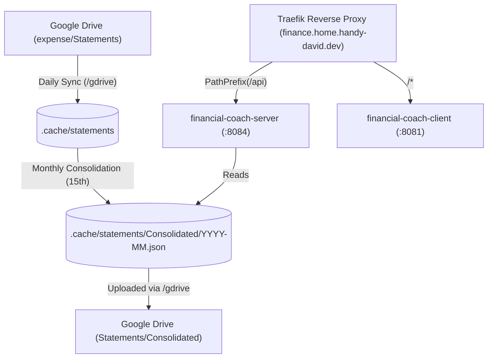

# Financial Coach

A personal finance platform combining automated Google Drive bank statement ingestion, a Deno + Hono REST API server, and a Vite + Lit Web Client dashboard deployed behind Traefik.

## Overview

Financial Coach helps you track your monthly expenses and balances by consolidating PDF bank statements from Google Drive (`expense/Statements/[Bank Name]/`) into a unified monthly statement (`YYYY-MM.json` and `YYYY-MM.pdf`) complete with AI financial coaching insights.

## Architecture

The project is organized as a Deno workspace deployed as two Docker Compose containers behind the shared Traefik reverse proxy (`https://finance.home.handy-david.dev`):



1. **Server (`/server`)**: A Deno + Hono server that serves consolidated monthly statements in JSON and CSV formats under `/api/statements/`.
2. **Web Client (`/web-client`)**: A Vite + Lit + WebAwesome single-page application that visualizes monthly statements, category breakdowns, and AI review commentary.
3. **Bank Statement Library (`/bank-statement`)**: Shared domain types, ISO `YYYY-MM` year-month utilities, MCC categorization, and statement storage helpers.
4. **Scheduled Automations (`.gemini/config/plugins/financial-coach/sidecars/`)**:
   - **Daily Download**: Syncs PDF bank statements from Google Drive `expense/Statements/[Bank Name]/` into `.cache/statements/[Bank Name]/`.
   - **Monthly Consolidation**: Runs on the 15th of each month to parse the previous month's PDF statements into `.cache/statements/Consolidated/YYYY-MM.json` and `YYYY-MM.pdf` and upload them back to Google Drive.

## Getting Started

### Prerequisites

- **Docker & Docker Compose**: For running the containerized services on `proxy-network`.
- **Traefik Reverse Proxy**: Running from `../reverse-proxy` on the external `proxy-network` network.
- **Deno** (v2.0+): For local development, unit testing, and linting.

### Storage Layout

All statements are stored locally under `financial-coach/.cache/statements/` (mounted into `financial-coach-server` at `/app/.cache/statements/`):

```text
financial-coach/.cache/statements/
├── AMEX/
│   └── *.pdf
├── Barclays/
│   └── *.pdf
├── Chase/
│   └── *.pdf
├── HSBC/
│   └── *.pdf
└── Consolidated/
    ├── YYYY-MM.json
    └── YYYY-MM.pdf
```

### Running with Docker Compose (Production)

Start both `financial-coach-server` and `financial-coach-client` behind Traefik:

```bash
docker compose up -d --build
```

- **Dashboard UI**: `https://finance.home.handy-david.dev/statements/2026-02`
- **Statement JSON API**: `https://finance.home.handy-david.dev/api/statements/2026-02.json`
- **Statement CSV API**: `https://finance.home.handy-david.dev/api/statements/2026-02.csv`

### Running Locally (Development)

Launch both the Server (`:8084`) and Web Client (`:8080`, with `/api` proxied to `http://localhost:8084`):

```bash
bash ./scripts/start.sh
```

## Development & Testing

1. **Run Unit Tests**:
   ```bash
   deno test
   ```
2. **Linting**:
   ```bash
   deno lint
   ```
3. **Formatting**:
   ```bash
   deno fmt
   ```

## License

MIT
